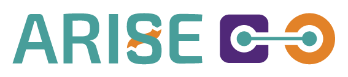

<picture>
  <source media="(prefers-color-scheme: dark)" srcset="images/ARISE_logo-dark_mode.png">
  <source media="(prefers-color-scheme: light)" srcset="images/ARISE_logo-light_mode.png">
  
</picture>

# generic_arm_controller

## About ARISE

ARISE aims towards making industrial HRI more accessible and cost-effective, in particular in healthcare, intra-logistics and manufacturing sectors. These modules hope to present an integration between FIWARE Orion Context Broker and eProsima Vulcanexus to enable context-aware robotic and industrial applications, alongside ROS4HRI as an open-source ROS standard and a set of ROS packages to facilitate the development of Human-Robot Interaction (HRI) capabilities on robots.

---

Robot-agnostic control stack for robotic arms: Cartesian motion through Pinocchio IK with
safety checks, forward kinematics, a generic gripper service, teaching and replaying pose
sequences (relative to the robot base or to an ArUco marker), and hand-eye calibration tools.
Everything robot-specific lives in one YAML **profile** per robot; the nodes have no
per-robot code.

This package is developed inside the
[`ros2_arise_vulcanexus`](https://github.com/JOiiNT-LAB/ros2_arise_vulcanexus) workspace. Links
starting with `../../../` point to that workspace's documentation (installation, simulation,
real hardware); this README covers the package itself.

- [Quick start](#quick-start)
- [Interface](#interface)
- [Robot profile reference](#robot-profile-reference)
- [Motion and IK safety](#motion-and-ik-safety)
- [Task system](#task-system)
- [Grippers](#grippers)
- [Hand-eye tools](#hand-eye-tools)
- [Other tools](#other-tools)
- [Package structure and tests](#package-structure-and-tests)
- [Troubleshooting](#troubleshooting)

## Quick start

`launch/robot_vision_ik_traj_setup.launch.py` is the only launch file. It starts the control
stack for the profile `config/robots/<robot>.yaml`:

- **Simulation**: don't call it directly; `arm_gz_bringup/bringup.launch.py robot:=<robot>` starts
  Gazebo and includes it ([launch options](../../../docs/robots-and-simulation.md)).
- **Real hardware**: start the robot driver, then this launch file directly
  ([real hardware](../../../docs/real-hardware.md)):
  ```bash
  ros2 launch generic_arm_controller robot_vision_ik_traj_setup.launch.py robot:=fr3_real enable_realsense:=true
  ```

| Argument | Default | Effect |
|---|---|---|
| `robot` | `ur10e` | profile `config/robots/<robot>.yaml` (`ur10e`, `fr3`, `fr3_real`) |
| `enable_realsense` | `false` | include `realsense2_camera/rs_launch.py` |
| `enable_qb` | `false` | include the QB SoftHand Industry driver |
| `enable_llm` | `true` | include `llm_app/llm_app.launch.py` after 3 s (needs `llm_app` and `launch_pal`) |
| `marker_id` / `marker_size` | `26` / `0.15` | ArUco marker id and side in metres |
| `aruco_image_topic` / `aruco_camera_info_topic` | `/camera/camera/color/image_raw` / `.../camera_info` | camera topics for `aruco_ros` |

The launch also publishes the hand-eye calibration
`calibration_results/hand_eye_transform_<robot>.yaml` as a static TF; **if that file is missing
the launch aborts**, unless the profile sets `hand_eye_tf_from_urdf: true` (camera already in
the robot model, as in the FR3 simulation).

### Dependencies

- [`generic_arm_interfaces`](https://github.com/JOiiNT-LAB/generic_arm_interfaces) (the
  `SavePose`/`GripperCommand` services). Outside the workspace: `vcs import < generic_arm_controller.repos`.
- **pip `pin`** (Pinocchio for NumPy 2.x), installed by the workspace Dockerfile. robotpkg's
  Pinocchio in `/opt/openrobots` must not be on `PYTHONPATH`/`LD_LIBRARY_PATH` at runtime,
  or `import pinocchio` crashes ([why](../../../docs/installation.md#full-build-first-time-or-after-touching-c-packages)).
- `aruco_ros`; optional `realsense2_camera`, `qb_softhand_industry_driver`, `franka_msgs`
  (native Franka Hand actions).

## Interface

| Node | Subscribes | Publishes | Services / actions |
|---|---|---|---|
| `ik_trajectory_node` | `/target_cartesian_pose` (PoseStamped), `/joint_states` | `/ik_action_result` (Bool), `/ik_action_result_reason` (String) | action client `FollowJointTrajectory` on `action_server_name` |
| `fk_node` | `/joint_states` | `/fk_pose` (PoseStamped, end effector in `base_frame`) | — |
| `gripper_node` | `/joint_states` (Robotiq feedback) | gripper-specific commands, see [Grippers](#grippers) | server `/gripper/command` (`GripperCommand`) |
| `task_saving_node_complete` | TF | static TF `aruco_marker_locked_teach` | servers `/save_pose` (`SavePose`), `/save_gripper_action` (`GripperCommand`), `/clear_saved_poses`, `/relock_marker` (`Trigger`) |
| `task_executor_node_complete` | `/ik_action_result`, `/ik_action_result_reason`, TF | `/target_cartesian_pose`, static TF `aruco_marker_locked_run` | server `/execute_saved_tasks` (`Trigger`); client `/gripper/command` |
| `aruco_single` (`aruco_ros`) | `aruco_image_topic`, `aruco_camera_info_topic` | TF `camera_color_optical_frame` → `aruco_marker`, `/aruco_single/pose` | — |

Topic names come from the profile (`pose_topic`, `fk_pose_topic`, ...); the values above are the
ones all current profiles use.

Command-line tools (`ros2 run generic_arm_controller <name>`): `validate_pipeline`,
`capture_hand_eye`, `evaluate_hand_eye`, `install_hand_eye`.

## Robot profile reference

One file per robot, `config/robots/<robot>.yaml`, passed to every node; each node reads only
the parameters it declares.

| Parameter | Read by | Meaning |
|---|---|---|
| `urdf_package`, `xacro_relative_path`, `xacro_args` | IK, FK | robot model loaded by `urdf_loader.py` (xacro processed at startup) |
| `robot_type` | IK, FK | passed to the model loader and logged |
| `base_frame` | IK, FK, task nodes | frame of every IK target and of absolute poses; **targets in another frame are refused** |
| `end_effector_frame` | IK, FK, task saving | frame the IK places and the task nodes record (FR3: the flange `fr3_link8` / `panda_link8`) |
| `joint_names` | IK | controlled joints, in controller order |
| `action_server_name` | IK | `FollowJointTrajectory` server of the trajectory controller |
| `pose_topic`, `joint_states_topic`, `ik_result_topic`, `fk_pose_topic` | IK, FK | topic names |
| `ik_tolerance`, `ik_max_iter`, `ik_dt`, `ik_damping` | IK | damped least-squares IK tuning |
| `trajectory_duration` | IK | minimum duration of a move, seconds |
| `max_joint_speed` | IK | rad/s; the trajectory is stretched so no joint goes faster. `0` disables |
| `max_joint_step_rad` | IK | a move where any joint travels more than this is refused. `0` disables |
| `default_gripper_type` | gripper | `robotiq`, `franka_hand`, `rg2`, `softhand` or `auto` |
| `franka_hand_gripper_action` | gripper | `control_msgs/GripperCommand` action of the Franka Hand |
| `franka_hand_native_actions`, `franka_hand_namespace` | gripper | use the native `franka_msgs` Move action under that namespace (real FR3) |
| `hand_eye_tf_from_urdf` | launch | don't publish the hand-eye file, the camera is in the robot model |
| `camera_optical_frame` | task nodes | camera frame used by the marker lock |
| `marker_min_reliable_distance_m` | task nodes | marker detections closer than this are discarded (0.20) |
| `marker_max_tf_age_s` | task nodes | detections older than this are discarded (0.5) |
| `marker_lock_samples` | task nodes | detections averaged to acquire a lock (5) |
| `marker_lock_mode` | executor | `once` (measure once per sequence, default) or `live` (every waypoint, debug only) |

Current profiles:

| | `ur10e` | `fr3` (sim) | `fr3_real` |
|---|---|---|---|
| `urdf_package` | `ur_description` | `franka_description` | `franka_description_panda_legacy` |
| `base_frame` → `end_effector_frame` | `base_link` → `tool0` | `fr3_link0` → `fr3_link8` | `panda_link0` → `panda_link8` |
| gripper | `robotiq` | `franka_hand` | `franka_hand`, native actions |
| hand-eye | file | robot model | file |

To add a robot, copy the closest profile and check the frames against the live TF
(`ros2 run tf2_ros tf2_echo <base_frame> <end_effector_frame>`); see
[adding a new robot](../../../docs/robots-and-simulation.md#adding-a-new-robot).

## Motion and IK safety

```bash
# frame_id must be the profile's base_frame (base_link, fr3_link0, panda_link0)
ros2 topic pub --once /target_cartesian_pose geometry_msgs/msg/PoseStamped \
  "{header: {frame_id: 'base_link'}, pose: {position: {x: 0.5, y: 0.2, z: 0.4}, orientation: {x: 0.0, y: 1.0, z: 0.0, w: 0.0}}}"
```

For each target `ik_trajectory_node` solves the IK from the current joint state and sends a
two-point trajectory. It **refuses** the target, sends no goal and publishes `false` on
`/ik_action_result` with the reason on `/ik_action_result_reason` when:

- the pose's `frame_id` is not `base_frame` (the node never transforms poses, so a pose in
  another frame would be silently misread);
- the pose contains NaN or infinite values;
- the IK solution contains NaN, or a joint would move more than `max_joint_step_rad`.

Otherwise the duration is `trajectory_duration`, stretched if needed so no joint exceeds
`max_joint_speed`. The checks are pure functions in `ik_safety.py` (`check_target_pose`,
`plan_trajectory_duration`), tested in `test/test_ik_safety.py`.

## Task system

Teach waypoints one at a time, then replay the whole sequence.

```bash
ros2 service call /save_pose generic_arm_interfaces/srv/SavePose \
  "{save_mode: 0, task_name: 'home', reference_frame: ''}"                    # absolute
ros2 service call /save_pose generic_arm_interfaces/srv/SavePose \
  "{save_mode: 1, task_name: 'grasp', reference_frame: 'aruco_marker'}"       # marker-relative
ros2 service call /save_gripper_action generic_arm_interfaces/srv/GripperCommand "{command: 'close'}"

ros2 service call /execute_saved_tasks std_srvs/srv/Trigger "{}"
ros2 service call /clear_saved_poses   std_srvs/srv/Trigger "{}"
ros2 service call /relock_marker       std_srvs/srv/Trigger "{}"            # re-measure the marker
```

| `save_mode` | `end_effector_frame` recorded relative to |
|---|---|
| 0 | `base_frame` |
| 1 | `reference_frame`, i.e. `aruco_marker` (the frame published by `aruco_single`; empty = `aruco_marker`) |

Any other value is refused. There is no camera-relative mode: the camera is mounted on the arm,
so the end effector is always at the same offset from it and such a pose would carry no
information. (Until October 2026 the marker mode was `2`; a request with `2` now gets an error
that says so. Saved sequences are unaffected: they store the frame, not the mode number.)

The sequence (poses and gripper actions, in order) is stored in
`~/ros2_ws/src/task_result/robot_poses_ws.json`. The executor publishes each pose on
`/target_cartesian_pose` and waits up to 20 s for `/ik_action_result`; gripper steps call
`/gripper/command` (10 s timeout). The sequence **stops at the first failed step**, because
the following steps were taught assuming it succeeded (e.g. closing the gripper after a move
that never happened): the response says which step failed, why, and how many were not executed. A short pause follows each successful step (0.4 s after
a move, 1.5 s after a gripper action), overridable per step with `sleep_time` in the JSON.

### Marker lock (mode 1)

Marker detections are noisy and disappear when the arm gets close, so the marker pose
relative to the base is **measured once** (average of `marker_lock_samples` detections, each
farther than `marker_min_reliable_distance_m` and younger than `marker_max_tf_age_s`) and then
reused for every waypoint of the sequence (`marker_lock.py`):

- while teaching, the lock is taken the first time the marker is seen and published as
  `aruco_marker_locked_teach`; if the object is moved, call `/relock_marker`;
- while replaying, every `/execute_saved_tasks` run drops the previous lock and takes a new
  one at its first marker-relative waypoint (`aruco_marker_locked_run`), since the object may
  have moved between runs.

The spread between the averaged samples is logged as a quality index. `check_saved_deltas.py`
(plain script) checks that consecutive marker-relative poses moved as much as the arm really did.

## Grippers

```bash
ros2 service call /gripper/command generic_arm_interfaces/srv/GripperCommand "{command: 'close'}"
ros2 service call /gripper/command generic_arm_interfaces/srv/GripperCommand "{command: 'open'}"
ros2 service call /gripper/command generic_arm_interfaces/srv/GripperCommand "{command: 'move', position: 0.5}"   # 0 open .. 1 closed
```

The gripper is chosen by the profile's `default_gripper_type` (the request's `gripper_type`
field is currently not used by `gripper_node`). `auto` picks the first available of Robotiq,
Franka Hand, RG2.

| Type | Driven through |
|---|---|
| `robotiq` | action `/robotiq_gripper_controller/gripper_cmd`, commands on `/robotiq_gripper_controller/commands` |
| `franka_hand` | action `franka_hand_gripper_action` (`control_msgs/GripperCommand`), or the native `<franka_hand_namespace>/move` action (for both open and close) when `franka_hand_native_actions: true` |
| `rg2` | `/finger_width_trajectory_controller/joint_trajectory` |
| `softhand` | service `/qb_softhand_industry_communication_handler/set_command` (start the driver with `enable_qb:=true`) |

On the real FR3 the gripper must be homed once per bring-up
(`ros2 action send_goal /panda_gripper/homing franka_msgs/action/Homing "{}"`), otherwise every
command fails with "out of range".

QB SoftHand Industry, direct control (position 0 = open … 3500, 3000 ≈ closed):

```bash
ros2 service call /qb_softhand_industry_communication_handler/activate_motors qb_softhand_industry_srvs/srv/Trigger "{}"
ros2 service call /qb_softhand_industry_communication_handler/set_command qb_softhand_industry_srvs/srv/SetCommand \
  "{max_repeats: 1, set_commands: true, position_command: 3000}"
```

## Hand-eye tools

Tools to check and install a hand-eye calibration solved by
[`handeye_ros2`](https://github.com/JOiiNT-LAB/handeye_ros2). Pure logic in `hand_eye/`
(`calibration_io.py`, `evaluate.py`), tested in `test/test_hand_eye.py`. The full workflow is in
[hand-eye calibration](../../../docs/hand-eye-calibration.md).

| Tool | Does | Main options |
|---|---|---|
| `capture_hand_eye --robot <r>` | records, while you move the arm with the fixed marker in view, the flange pose **at the timestamp of each detection** and the marker pose; writes `<ws>/calibration_results/captures/<r>_<UTC time>.json` | `--duration` (40 s), `--period` (0.4 s), `--marker-topic` (`/aruco_single/pose`), `--camera-root-frame` (`camera_link`), `--out` |
| `evaluate_hand_eye --capture <json> [--robot <r>] [file.yaml ...]` | scores calibrations by how still the fixed marker stays in the base frame; `--robot` adds the one in use. Exit 1 if the first one exceeds `--max-spread-mm` (5) | `--fit` (best calibration the data support), `--write-fit FILE` |
| `install_hand_eye --robot <r>` | checks frames and size of the change (refuses > 100 mm / 20° without `--force`), backs up the current file to `<ws>/calibration_results/history/`, writes `calibration_results/hand_eye_transform_<r>.yaml` through the install symlink so the tracked source file is updated | `--from FILE` (default: the latest `handeye_ros2` result), `--dry-run`, `--force` |

`install_hand_eye` refuses profiles with `hand_eye_tf_from_urdf` (the FR3 simulation reads
the `fr3_real` file: install for `fr3_real`).

## Other tools

`validate_pipeline` runs move → confirm arrival on `/fk_pose` → save → replay → cleanup with
the stack running, prints PASS/FAIL and exits 1 on failure:

```bash
ros2 run generic_arm_controller validate_pipeline                      # UR10e defaults (base_link)
ros2 run generic_arm_controller validate_pipeline --base-frame fr3_link0 --pose1 0.3,0.0,0.5 --pose2 0.3,0.0,0.3
```

Step-by-step manual version: [validation tutorial](../../../docs/validation-tutorial.md).

## Package structure and tests

```
generic_arm_controller/
├── launch/robot_vision_ik_traj_setup.launch.py
├── config/robots/{ur10e,fr3,fr3_real}.yaml        robot profiles
├── calibration_results/hand_eye_transform_<robot>.yaml
├── generic_arm_controller/
│   ├── ik_trajectory_node.py, ik_safety.py, urdf_loader.py, fk_node.py
│   ├── gripper_manager.py                         (executable: gripper_node)
│   ├── task_saving_node_complete.py, task_executor_node_complete.py, marker_lock.py
│   ├── capture_hand_eye.py, evaluate_hand_eye.py, install_hand_eye.py, hand_eye/
│   └── validate_pipeline.py, check_saved_deltas.py
└── test/  test_ik_safety.py, test_hand_eye.py + ament linters
```

```bash
colcon test --packages-select generic_arm_controller && colcon test-result --verbose
python3 -m pytest test/test_ik_safety.py test/test_hand_eye.py
```

## Troubleshooting

| Symptom | Check |
|---|---|
| Arm doesn't move after a target | `ik_trajectory_node` log / `/ik_action_result_reason`: wrong `frame_id`, joint step too large, IK not converging, action server missing (`ros2 action list`) |
| Node crashes on `import pinocchio` | `/opt/openrobots` in `PYTHONPATH`/`LD_LIBRARY_PATH`, see [Dependencies](#dependencies) |
| Launch aborts with `FileNotFoundError` | no `calibration_results/hand_eye_transform_<robot>.yaml` |
| Marker-relative save/replay fails | marker in view, > 0.20 m from the camera, right `marker_id`/`marker_size`; `ros2 topic echo /aruco_single/pose` |
| Gripper fails | profile's `default_gripper_type`; real FR3: homing; SoftHand: `enable_qb:=true` and `activate_motors` |

More: [workspace troubleshooting](../../../docs/troubleshooting.md).

## License

Apache-2.0. Maintained by JOiiNT-LAB.

---


Funded by the European Union. Views and opinions expressed are however those of the author(s) only and do not necessarily reflect those of the European Union or HADEA. Neither the European Union nor the granting authority can be held responsible for them.
